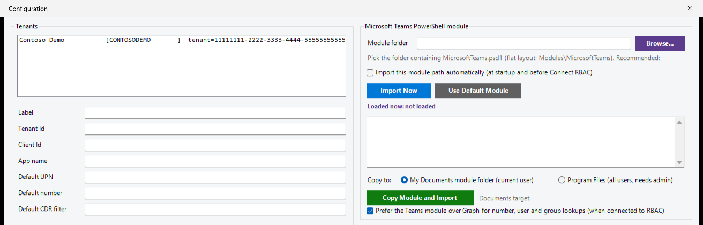
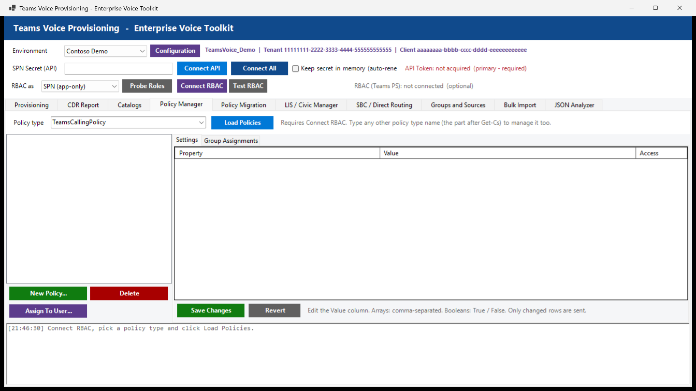

# TeamsVoiceTool

A PowerShell 7 WinForms toolkit for Microsoft Teams Enterprise Voice. It provisions and reads users and resource accounts, manages telephone lines and policies, and pulls call records, all from one window.

**Package version: 1.1.0.** See [CHANGELOG.md](CHANGELOG.md) for release history.


## Features

- **Unified Provisioning tab.** Read a user or resource account, see every assigned phone line, and edit and provision a number with its policies in one place. Read Settings fills the policy drop-downs with the values the user actually has.
- **Multiple phone lines.** Up to 11 lines per user (1 primary, 1 private, 9 alternate). Mix Calling Plan, Direct Routing, and Operator Connect. Alternate lines use the MicrosoftTeams module through RBAC.
- **Policy Manager.** Load any `Get-Cs*Policy` type, edit its settings, create or delete policies, and manage group assignments.
- **Resource Accounts.** Build and manage resource accounts with the same features as the Teams admin center.
- **Configuration popup.** Manage tenants, choose a Microsoft Teams module folder, import it, and copy it to a default location (current user Documents, or Program Files with admin rights).
- **Teams-first lookups.** When connected to RBAC, number, user, and group lookups use the MicrosoftTeams module (7.8 recommended) and fall back to Graph where the module lacks a cmdlet. This is controlled by a checkbox.
- **CDR, catalogs, SBC/Direct Routing, groups, bulk import, and a JSON analyzer** in the other tabs.





## Requirements

**Software**

- Windows with **PowerShell 7** (`pwsh`), recommended. Windows PowerShell 5.1 also works.
- For RBAC features: the **MicrosoftTeams** module, version **7.8** recommended. Install it with `Install-Module MicrosoftTeams -RequiredVersion 7.8.0`, or point the Configuration popup at a copy. This is the only module the tool imports.
- Network access to `login.microsoftonline.com` and `graph.microsoft.com`.

**App registration (SPN), one per tenant**

- Application permissions, with admin consent granted: `User.Read.All`, `Group.Read.All`, `Organization.Read.All`, `RoleManagement.Read.Directory`, `TeamsTelephoneNumber.Read.All`, `TeamsTelephoneNumber.ReadWrite.All`, `TeamsPolicyUserAssign.ReadWrite.All`, `TeamsUserConfiguration.Read.All`, and `CallRecords.Read.All` for CDR reports.
- Directory role **Teams Administrator**, assigned to the SPN at **Organization** scope (tenant-wide, not an Administrative Unit). RBAC needs this role. Without it, cmdlets return empty results rather than errors.
- One client secret serves both Graph and RBAC. When it expires, both stop working.

**Signed-in user**

- Interactive writes to resource accounts need Teams Administrator, or Teams Telephony Administrator for telephony-only changes. Trusted IP writes need Teams Administrator.

The [operator guide](Docs/TeamsVoiceProvisioning_Instructions.md#10-permissions-reference) has the step-by-step SPN setup, the full permission table, and the troubleshooting notes.

## Getting started

1. Extract `TeamsVoiceTool-v1.1.0.zip` to a writable folder, or clone the repo.
2. Open a PowerShell 7 window in the extracted or cloned folder.
3. Launch the tool:

   ```powershell
   pwsh -NoProfile -ExecutionPolicy Bypass -File .\TeamsVoiceProvisioning.ps1
   ```

4. Click **Configuration** and add a tenant (label, tenant ID, client ID, and defaults). The tool stores no client secrets. Enter the secret in the SPN Secret box each session.
5. Click **Connect API**, then **Connect RBAC** if you need phone number and policy features.

The [operator guide](Docs/TeamsVoiceProvisioning_Instructions.md) covers setup, each tab, required permissions, licensing, and troubleshooting.

## Your data stays local

The tool writes tenant data beside the script. `.gitignore` excludes these files so they never reach the repo:

- `TeamsVoice_Tenants.csv` and `TeamsVoice_Environments.csv` (tenant and client IDs)
- `TeamsVoice_Settings.json`
- `Catalogs/` (location and policy catalogs)
- `TeamsVoice_Output/` (call records, reports, backups, and logs)

Without these files the tool starts with an empty tenant list and shows the Configuration prompt. Add a tenant to begin.

The screenshots in this README use demo data (a fictional "Contoso Demo" tenant and 555 numbers).

## Repository layout

| Path | Contents |
| --- | --- |
| `TeamsVoiceProvisioning.ps1` | The application |
| `Docs/` | Operator guide and screenshots |
| `Scripts/` | Helper scripts (for example, the socket trace) |

## License

Released under the [MIT License](LICENSE).
